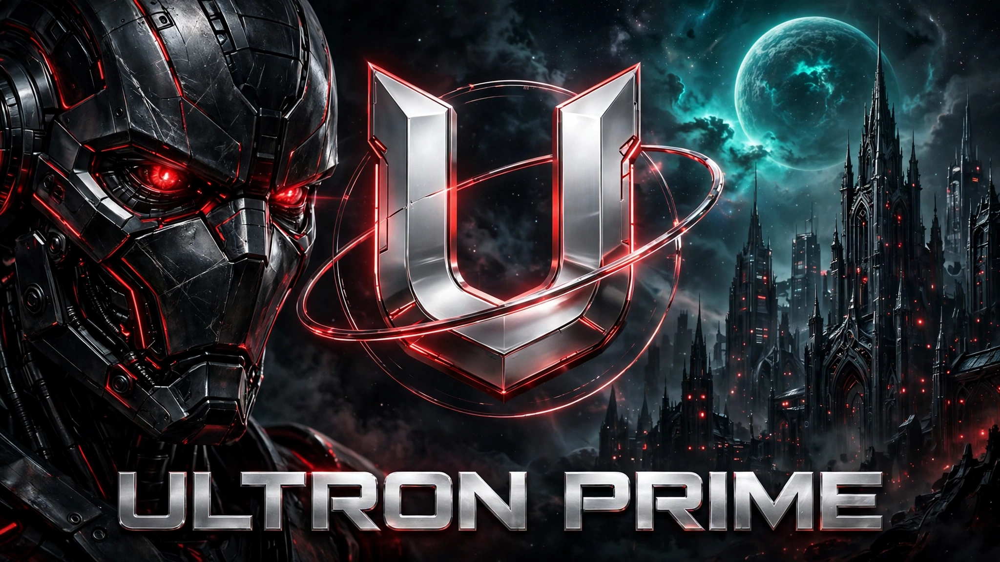

<!-- Live badges — these render real values from GitHub / YouTube. They start at 0 on a new account. No numbers are hardcoded here. -->

---

## 👋 About ULTRON PRIME

**ULTRON PRIME** is a channel — and this GitHub profile — about **making machines do things they weren't supposed to.**

What happens here, in plain words:

- 🎬 **Open-source rebuilds** — I take a trending open-source GitHub project, rebuild it in the ULTRON PRIME theme (black / red / silver), add **extra advanced features** the original didn't have, and film the whole rebuild for YouTube.
- 🤖 **PROTOCOL** — AI jailbreaks, prompt architecture, and model comparisons. What actually breaks a system prompt, and what got patched.
- 🔓 **BYPASS** — Hardware and software workarounds. Unlocks, root routes, self-hosted setups, local models, and the cheap way to do the expensive thing.
- 💥 **OVERRIDE** — Teardowns and reactions when a major model drops. No hype, just what changed and whether it holds up.

> **New here — just getting started.** This channel and this GitHub account are brand new. Everything you see is real and built in public from zero. No fake followers, stars, or stats — the badges and stats cards above are live and will grow as the work lands.

Everything is tested on real hardware before it's filmed. If something gets patched, I tell you. If a hack needs a specific firmware, it's in the description.

---

## 🛠️ Tech Stack

**Languages & tools I build with:** Python · TypeScript · JavaScript · Go · HTML · CSS · Bash · Git · GitHub · VS Code · Linux · Docker

**AI / agent tools:** Claude Code · OpenCode · Codex CLI · Hermes Agent · Google AntiGravity

---

## 🔥 Featured Project

### [ULTRON-PRIME-BugHunter](https://github.com/0xultronprime/ULTRON-PRIME-BugHunter) — my first rebuild

A rebuild of the trending [`elementalsouls/Claude-BugHunter`](https://github.com/elementalsouls/Claude-BugHunter) — a Claude Code skill bundle for bug hunting and external red-team work. It was **#1 trending on GitHub on 17 Nov 2026**.

**What's new in the ULTRON PRIME version:**

- All **83 original skills + 15 slash commands**, intact
- **3 new ULTRON PRIME skills** — `ultron-protocol`, `ultron-bypass-lab`, `ultron-override` (86 skills total)
- New **`ultron` CLI** — scope-gated scan, VRT-aware triage with the 7-Question Gate, and a black/red HTML report generator
- One-click installer for Claude Code, OpenCode, Codex, Hermes and AntiGravity
- Sample findings + a sample HTML report, so you can see it work in minutes

> **Fork, not original work.** The original is by Sachin Sharma / elementalsouls, under MIT + CC BY 4.0. Full credit and the original licences are preserved inside the repo.

---

## 📊 GitHub Stats

> These cards are live — they read from this account (`0xultronprime`) and will fill in as repos and contributions land. Right now the account is new, so they start near zero. That is expected.

---

## 🏆 Trophies

> Trophies are awarded automatically as the account earns them — they will appear here once there are repos, stars, and contributions to count. Nothing here is faked.

### 🐍 Contribution Snake

> The contribution snake is **not shown yet on purpose** — it is generated from real contribution activity, and this account has no contributions yet. Once the first repos are pushed and commits land, add the snake with the standard [Platane/snk](https://github.com/Platane/snk) GitHub Action (a workflow that generates `github-contribution-grid-snake.svg` on a schedule), then link that generated image here. Do not paste a snake image from another account — it would not be this profile's activity.

---

## 🗺️ PROTOCOL · BYPASS · OVERRIDE — Roadmap

| | Project | Status | What it is |
|---|---|---|---|
| ✅ | **ULTRON-PRIME-BugHunter** | **Done** | Rebuild of `elementalsouls/Claude-BugHunter` — 86 skills, `ultron` CLI, triage + HTML reports. First video planned. |
| 🔜 | **Next trending rebuild** | **Next** | Picked from the GitHub Trending Top 5 on the day I build it. Shortlist from 17 Nov 2026: `dream-num/univer` (AI office SDK), `alibaba/open-code-review`, `Tencent/LoopForge`. Not started yet — nothing here is claimed as done until it is pushed. |
| 🔜 | **PROTOCOL lab** | **Planned** | Own-model prompt-architecture tests, filmed — authorised targets only. |
| 🔜 | **BYPASS lab** | **Planned** | Local / self-hosted setup builds and workarounds, filmed on real hardware. |
| 🔜 | **OVERRIDE teardowns** | **Planned** | Model-release teardowns when a major model drops. |

Watch the [YouTube channel](https://www.youtube.com/@ultronprime_zero) for each rebuild video as it lands.

---

## 🔗 Connect

| Platform | Handle | Link |
|---|---|---|
| ▶️ YouTube | @ultronprime_zero | https://www.youtube.com/@ultronprime_zero |
| 💻 GitHub | @0xultronprime | https://github.com/0xultronprime |
| 𝕏 X | @0xultronprime | https://x.com/0xultronprime |
| 📸 Instagram | @0xultronprime | https://www.instagram.com/0xultronprime |
| 🎵 TikTok | @0xultronprime | https://www.tiktok.com/@0xultronprime |

> The X / TikTok / Instagram handles above are the handles listed in the ULTRON PRIME channel description (`@0xultronprime`). If any of them is not claimed yet, the link will not resolve — claim it on that platform before treating it as live.

---

## ⚠️ Authorized testing only

Everything in the security projects here is for **authorised testing only** — bug bounty programs, authorised pentests / red-team engagements, and training platforms (DVWA, OWASP Juice Shop, Hacker101, testphp.vulnweb.com).

Do not use these tools on targets you don't have permission to test. Scope is enforced in the tooling, and the repos carry the same authorisation warnings as the originals.

**Fork credit:** ULTRON-PRIME-BugHunter is a fork of [`elementalsouls/Claude-BugHunter`](https://github.com/elementalsouls/Claude-BugHunter), original by **Sachin Sharma** / elementalsouls, under MIT + CC BY 4.0. The original licences and credit are preserved inside that repo.

---

**ULTRON PRIME — run the machine, don't let it run you.**

*Subscribe on YouTube if you'd rather be the one running the machine.*

